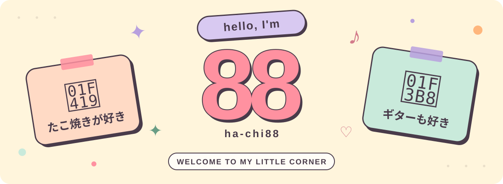

<picture>
  <source media="(max-width: 600px)" srcset="./assets/hello-88-mobile.svg">
  
</picture>

 

<h3 align="center">こんにちは、88です！</h3>

  たこ焼きとギターが好きです。 
  ふらっとのぞいていってください。🐙 🎸

Thanks for stopping by ♡

