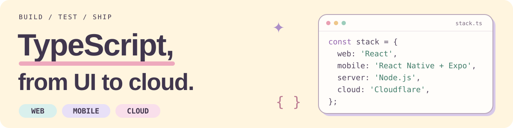

<picture>
  <source media="(max-width: 600px)" srcset="./assets/web-mobile-header-compact.svg">
  
</picture>

TypeScript を中心に、React / React Native / Expo で Web・モバイルを開発しています。 
Node.js と Cloudflare を使って、実装から公開まで。

  
  
  
  
  
  

## ✦ Tech stack

| Layer | Tools |
| :--- | :--- |
| **Language** | [TypeScript](https://www.typescriptlang.org/) |
| **Web** | [React](https://react.dev/) |
| **Mobile** | [React Native](https://reactnative.dev/) · [Expo](https://expo.dev/) |
| **Runtime** | [Node.js](https://nodejs.org/en) |
| **Cloud** | [Cloudflare](https://developers.cloudflare.com/workers/) |

## ✦ Engineering interests

- **Web × Mobile** — Web とアプリを、共通化とそれぞれの操作感の両方から考える。
- **UI & DX** — 使いやすい画面と、開発を続けやすいコンポーネント設計。
- **Build & Ship** — Node.js / Cloudflare を使って、つくったものを届けるところまで。

---

Off the keyboard: たこ焼きとギター。🐙 🎸
