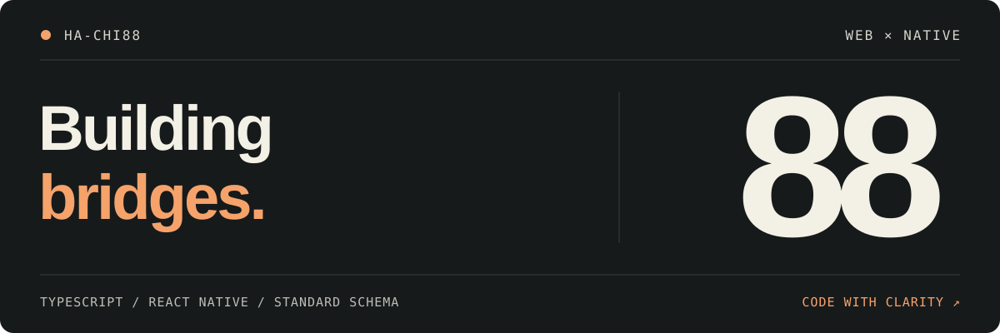

<picture>
  <source media="(max-width: 600px)" srcset="./assets/profile-header-mobile.svg">
  
</picture>

 

### Web と Native のあいだを、もっとなめらかに。

TypeScript で、Web と React Native をつなぐ道具をつくっています。

<code>TypeScript</code> &nbsp; <code>React&nbsp;Native</code> &nbsp; <code>Standard&nbsp;Schema</code>

 

## 01 / Selected work

### [safe-webview-bridge ↗](https://github.com/ha-chi88/safe-webview-bridge)

Web と React Native WebView をつなぐ、型付きの双方向メッセージング。

- **Typed contracts** — スキーマから送信・受信の型を推論。
- **Runtime validation** — Standard Schema による受信時の検証と変換。
- **Clear boundaries** — Web / Native を個別にインポート。React やスキーマライブラリへの実行時依存なし。

**[Read the docs →](https://github.com/ha-chi88/safe-webview-bridge#readme)** &nbsp;&nbsp;
[Explore the source](https://github.com/ha-chi88/safe-webview-bridge/tree/main/src) &nbsp; · &nbsp;
[Security model](https://github.com/ha-chi88/safe-webview-bridge/blob/main/SECURITY.md)

 

---

<b>88 / ha-chi88</b> &nbsp; · &nbsp; Small tools. Clear contracts.
 
<a href="https://github.com/ha-chi88?tab=repositories">Browse repositories ↗</a>
