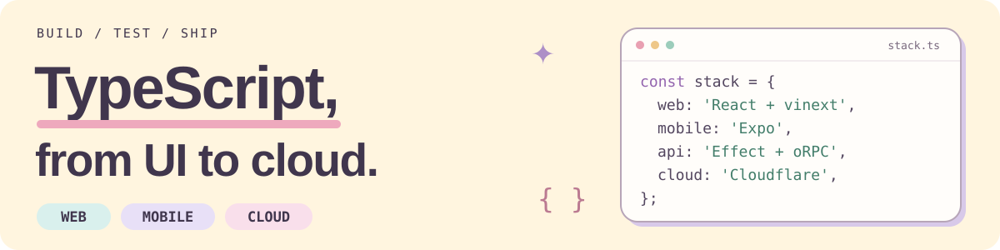

<picture>
  <source media="(max-width: 600px)" srcset="./assets/engineering-header-mobile.svg">
  
</picture>

TypeScript を軸に、Web・モバイルから API・インフラまで開発しています。 
UI の使い心地と、変更に強い設計。どちらも大切に。

  
  
  
  
  
  

## ✦ Tech stack

| Layer | Tools |
| :--- | :--- |
| **Web** | [React](https://react.dev/) · [vinext](https://github.com/cloudflare/vinext) · [Tailwind CSS](https://tailwindcss.com/) |
| **Mobile** | [React Native](https://reactnative.dev/) · [Expo](https://expo.dev/) |
| **API** | [Effect](https://effect.website/) · [oRPC](https://orpc.dev/) · [Hono](https://hono.dev/) · [Better Auth](https://better-auth.com/) |
| **Data** | [Drizzle ORM](https://orm.drizzle.team/) · [Turso](https://turso.tech/) |
| **Cloud** | [Cloudflare Workers](https://developers.cloudflare.com/workers/) · [Alchemy](https://alchemy.run/) |
| **Tooling** | [Vite](https://vite.dev/) · [pnpm](https://pnpm.io/) · [Vitest](https://vitest.dev/) · [Playwright](https://playwright.dev/) |

## ✦ Engineering interests

- **Type-safe APIs** — Effect によるスキーマ・エラー設計と、oRPC による型付き API。
- **Web × Mobile** — React と Expo を中心に、共通化とプラットフォームごとの使い心地を両立。
- **Developer experience** — モノレポ、再利用できる開発基盤、テストとデプロイの自動化。

---

Off the keyboard: たこ焼きとギター。🐙 🎸
